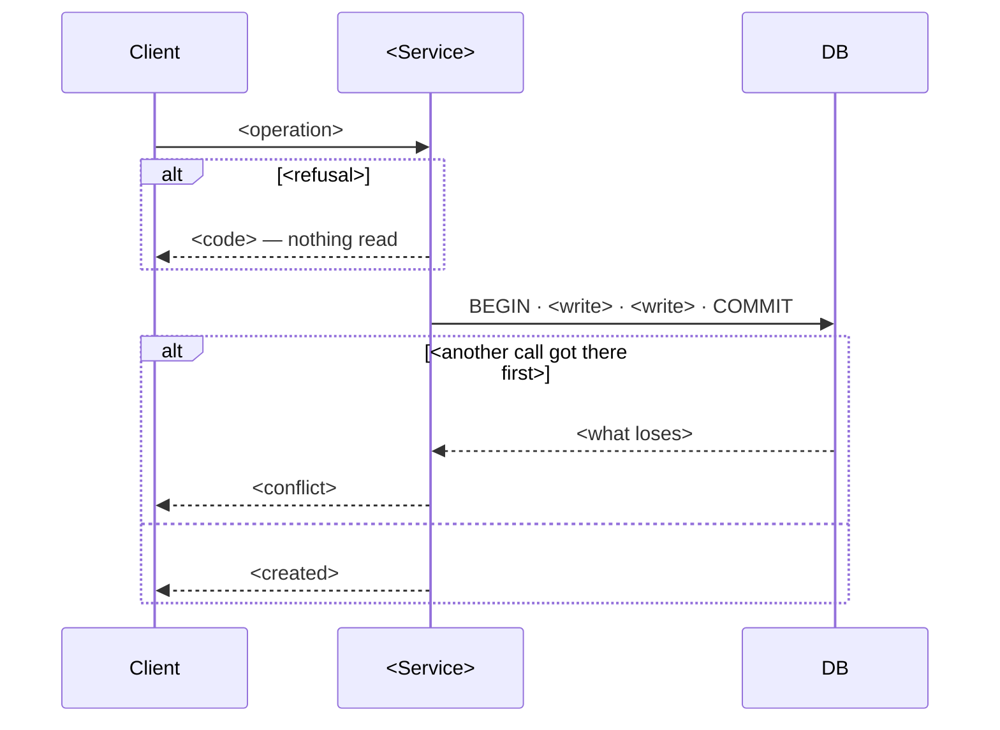

# Design document format

Load this file only when writing `.design/<name>.md` — after the verdict is confirmed, or after recording a committed decision. Do not load it during the interview.

This file is the shape of the document. The rules for what goes in it - one home per fact, what earns a place, the identifier ceiling, the size budget - are in `SKILL.md` under "What the document holds" and are not repeated here.

**Headings follow the language of the document.** The set and the order below are fixed; the words are translated, and identifiers and slice names never are. A Portuguese set is given after the template; for any other language, translate the same set. The validator recognises the English and Portuguese sets.

Replace every placeholder with a concrete value, or omit the section. A heading with "N/A" under it does not appear.

## Template

Write `.design/<name>.md`.

````markdown
# <Title>

| | |
|---|---|
| **Status** | <draft \| confirmed by <who, role>, <date>, in <document> \| declined - <reason>, <who>, <date> \| superseded by <path>> |
| **Record** | <only when this file is not the source of record: where the record lives> |
| **Ready to plan?** | <n slices clear, n with defaults taken, n waiting on rfc / spike / design - and what that blocks> |
| **Blocks go-live** | <what must be settled before release even though the build can start - omit the row when nothing> |
| **Review** | <date or trigger> - <who looks, with role> |

**How to read.** From Summary to Open is the design the team aligns on. Slices cuts the work: one section per slice, with its rules, its contract and the data that matters. The spec of each feature starts from its slice and details the rest against the code.

## Summary

<Two or three sentences a person outside the room understands: what exists today, what this builds, what it deliberately does not.>

<The design in three or four numbered ideas, one line each.>

**What is expensive to get wrong:** <the door, and what changing it later costs>.

## Context and problem

**Where the project is.** <in steady use | not shipped yet | in active construction - and what that means for this problem.>

**<Lead-in for each fact of the problem.>** <Pain: who hurts, named; what it costs today, in a unit the business feels; what happens if nothing changes. Absence: who cannot do this, and what they do instead. Construction: what this piece was promised to make possible, what stalls without it, and why now rather than after the next piece. One short labelled paragraph per fact. No solution proposed.>

**What this reuses.** <The precedent it copies and what stays out, one sentence each. No commit hashes.>

<### Evidence - only when the reader needs more than one number to trust the problem. Usage numbers in a table with the reading of each and the source; what the code does today as a labelled list. The number that would change the verdict, in one line. Never the decision's working.>

## How we will know it worked

| What to watch | Target | How to measure |
|---|---|---|
| <outcome, in the problem's own unit> | <value, and by when> | <the event, column or report - or "not measurable yet", and then it is a row in Open> |

**Signs it is going wrong:** <what the early signal looks like, as a short list>.

## Scope

**In**

- <what this covers, one item per line>

**Out**

| Left out | Why / where it lands |
|---|---|
| <excluded> | <reason, or the slice of work that owns it> |

**Unchanged** (so nobody hunts): <existing identifiers a reader might expect to change and that do not, as a list>.

## How it works

### Overview

<One diagram of the whole: who calls what, in the order it happens. A flowchart for components, or the journey as a flow of screens when the work is a user-visible sequence. Then three or four lines saying what each arrow means. For a journey, the numbered steps below the diagram, one line each.>

### <Lifecycle - only with three or more states, or two or more writers>

<State diagram of the record the design is about, and one line saying which states carry access, cost or whatever the product cares about.>

### Data model

<Entity diagram when the design relates more than one record, checked against the code.>

| Record | Role | New? | Detail in |
|---|---|---|---|
| `<table or record>` | <what it is for, in a clause> | <new \| gains `<column>` \| exists> | [<Slice>](#<anchor>) |

### Vocabulary

| Term | Means |
|---|---|
| **<term this document coins>** | <one line. Only terms the document invents or uses in a special sense. A term from the product or the roadmap is explained in a clause the first time it appears, not here> |

### <Heavier alternative | Lighter alternative>

<The other shape in one sentence.>

- **Why not now:** <the present-tense condition that does not hold>
- **When it wins:** <what would have to become true>
- **What this design does not survive:** <what would force the rewrite>

## Key decisions

<One line saying these are the hard-to-reverse decisions and that slices cite them by code.>

| | Decision | Slices it affects |
|---|---|---|
| D1 | <the decision as a short name> | <slice, slice> |

### D1 — <the same short name>

**Rule.** <The invariant, one or two sentences. What must hold, never how. The record or constraint that carries it is in the slice's Data, not here.>

**Consequence.** <What follows for a caller or for the next piece of work.>

**Careful.** <Only where the obvious precedent would break the rule: name the precedent and say not to copy it.>

**Alternative.** <Only when a reader might reasonably raise it: the option, and the condition under which it wins.>

<Five to eight. If it needs more, the shape has not been found. Most decisions are Rule and Consequence and nothing else; a decision with all four labels is the exception.>

## Open

<One line: what needs somebody to decide or act before this can ship, each with an owner. Defaults taken are not here: they live in their slice.>

| Item | Where it stands | Blocks | Where |
|---|---|---|---|
| <question, or the thing not verified> | <rfc - not decided \| spike \| needs design \| cited from memory, not re-read \| pending with <who, role>> | <the spec of <slice>, or go-live of <slice> - every one it blocks> | [<Slice>](#<anchor>) |

## Slices

| Slice | Delivers | Status |
|---|---|---|
| [<Slice>](#<anchor>) | <what exists when it is done, one line> | clear \| clear — <n> defaults taken \| clear — go-live waits on <open item> \| blocked by <slice or open item> \| rfc \| spike \| design |

**Order:** <slice → slice → slice>. <What runs in parallel and what it blocks.>

**Already handled by existing code** (not a task):

- <journey state> → <what handles it>

**Left to the spec** (derivable from the repository, all as <existing record> does them): <conventions, in one line>.

---

### <Slice - a domain term or a code identifier, never a prose verb>

> **Delivers:** <one sentence>.
> **Status:** <status> · **Applies:** D<n> (<short name>), D<n> (<short name>) · **Depends on:** <slices, or nothing> · **Screens:** <only for a slice with interface>

**Behaviour**

| Situation | What happens | Response |
|---|---|---|
| <the states that earn a place: the product decision, the race, the failure that must leave nothing behind> | <the product outcome: what is saved, refused, unchanged> | <code, and the reason string where the string is a decision> |

<Usually four to six rows. Input validation and the errors every API has are the spec's. Third column omitted for a slice with no caller.>

**Contract**

`<METHOD> <path>` `<essential request>` → `<code>` `<response>` — <who consumes it>
<One line per endpoint this slice adds or changes. Then any contract that is not HTTP: provider events subscribed to, a record another channel reads, a public interface another module calls.>

**Data** <only where this slice creates or alters a record>

<New record `<name>`: <its role>. `<existing record>` gains `<field>`.>

| Field or constraint | What it means |
|---|---|
| `<record.field>` | <only fields and constraints that carry a decision: the unique that is a business rule, the nullable id whose null means something> |

<No types, nullability or indexes: those are the spec's.>

**Events** <only where the slice emits one>: `<event name>` — <what it carries, when another team will read it>.

**Flow** <only where this slice holds a one-way door. Participants are layers, not files; steps are the refusal, the read, the transaction, the race.>



**Alternatives considered**

- <option> — wins if <condition>. <Only reversible alternatives a reader might raise. Costly ones are in Key decisions.>

**Open — defaults taken** <only in a slice that has them>

1. <question>. **Default: <default>.** <Why, in a clause.>

**<RFC | Spike | Needs design>** <only in a slice whose status says so>

- RFC: <question> - <who decides> - <what it blocks>. Not decided. <Recommended direction, if there is one.>
- Spike: <question only building answers> - <what each answer changes> - <when it stops>
- Design: <screen or flow> - <the states the drawing has to answer for>

---

### <Next slice>

...

## Migration

<Only when the product is in use. Existing rows, backfill, deploy order, what an old client sees before it updates. Each step in the mechanism the repository uses to change data, and only what that mechanism can do - run once or again, schema or data. In construction, omit.>

## References

<### What others learned - only when the research went beyond the vendor's own documentation. A table: practice, do we, why. What the vendor recommends is cited in the decision that follows it, not listed here.>

- <roadmap, decision record, earlier design document, external reference> — <what it settles>. <Mark anything cited from memory and not re-read.>
````

## Headings in Portuguese

| English | Português |
|---|---|
| How to read | Como ler |
| Summary | Resumo |
| Context and problem | Contexto e problema |
| Evidence | Evidência |
| How we will know it worked | Como saberemos que funcionou |
| Scope · In · Out · Unchanged | Escopo · Dentro · Fora · Não muda |
| How it works · Overview · Lifecycle · Data model · Vocabulary | Como funciona · Visão geral · Ciclo de vida · Modelo de dados · Vocabulário |
| Heavier alternative · Lighter alternative | Alternativa mais pesada · Alternativa mais leve |
| Key decisions · Rule · Consequence · Careful · Alternative | Decisões-chave · Regra · Consequência · Cuidado · Alternativa |
| Open | Em aberto |
| Slices · Order · Already handled by existing code · Left to the spec | Fatias · Ordem · Já resolvido pelo código existente · Deixado para a spec |
| Delivers · Status · Applies · Depends on · Screens | Entrega · Status · Aplica · Depende de · Telas |
| Behaviour · Contract · Data · Events · Flow | Comportamento · Contrato · Dados · Eventos · Fluxo |
| Alternatives considered · Open — defaults taken | Alternativas consideradas · Em aberto — defaults assumidos |
| Migration · References · What others learned | Migração · Referências · O que aprendemos com quem já fez |
| clear · blocked by · defaults taken · go-live waits on | clara · bloqueada por · defaults assumidos · go-live aguarda |

Slice names are not translated: they are domain terms or code identifiers.

## Section notes

Only what the template cannot show by itself.

**Never omitted when the verdict is build:** the header, Summary, Context and problem, How we will know it worked, Scope, How it works with its Overview, Key decisions, Slices. A declined document is the header, Summary, Context and problem and Scope; what would have to become true to reopen it goes in Scope.

**The header** is the only place the verdict appears. "Ready to plan?" counts the slices by status and says what the rest are waiting on; it does not say yes while an undecided item blocks the first slice.

**How we will know it worked** always has the measurement beside the target. A target nobody can measure yet says so in that cell and has a row in Open. When nobody defined success, the section says exactly that in one line and Open carries the row with who decides.

**Scope**: Out is what is not built, Unchanged is what is not touched. Both stop a spec inventing a task.

**Vocabulary** holds only the terms this document coins or uses in a special sense. A term from the product or the roadmap is explained in a clause where it first appears. An external numbering scheme gets one line saying where its list lives.

**Journey** has no section. When the work is a user-visible sequence, the Overview shows it as a flow with the steps one line each; the states land in the behaviour tables of the slices.

**Open** has no defaults in it. Its Blocks column names every slice an item blocks and whether it blocks the spec or only go-live. A slice whose spec is blocked says `blocked by` in its status; one whose release alone waits stays `clear` and says what go-live waits on.

**References** is a short list, each entry with what it settles. It links another document; it never copies its tables. Every provider page a decision relies on is here with the date it was read.

**Before handing over**, run `scripts/validate_design.py` on the file and follow "Before you hand it over" in `SKILL.md`.
