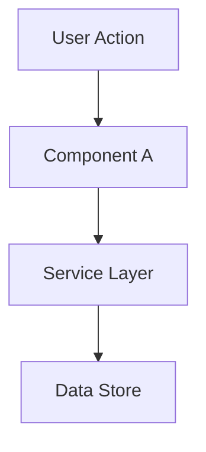

# Design

**Goal**: Define HOW to build it: the approach, the components, and what to reuse.

**When:** Large and Complex scopes. A Medium feature designs inline during Execute.

## Process

### 1. Load Context

Read `.specs/features/[feature]/spec.md` before you design. Read `context.md` too when it exists. Its decisions constrain the design, and the ones marked "Agent's Discretion" are yours.

**Read `.specs/STATE.md` `## Decisions` now, before any architectural choice.** Every `active` `AD-NNN` is a constraint this design meets. When a past decision conflicts with this feature, choose one of two paths:

1. **Conform.** Design within the decision.
2. **Supersede.** Append a new `AD-NNN` that supersedes the old one, and set the old Status to `superseded by AD-NNN`. Run `python3 <skill-dir>/scripts/validate_state.py`.

Ignoring an active decision is not a path. It creates inconsistency nobody sees.

**Load confirmed lessons** for this area: `python3 <skill-dir>/scripts/lessons.py list --status confirmed`. They are past failures turned into guidance ([lessons.md](lessons.md)).

### 2. Research When the Ground Is New

Research before you design when the feature touches unfamiliar technology, patterns or integrations. Follow this order:

```
Codebase → Project docs → Context7 MCP → Web search → Flag as uncertain
```

**Never assume or invent.** When the chain finds nothing, say "I could not find documentation for this". A wrong assumption here spreads into the tasks and the code.

**Flag concerns while you read the code.** Write each one in `## Risks & Concerns` with its `file:line` and a mitigation. Look for fragile code, tech debt, security risks, performance bottlenecks and untested paths this feature depends on.

### 3. Choose the Approach With the User

Present 2 or 3 approaches that deliver the same scope. Lead with your recommendation, then give the strongest case against it. Each approach states the condition under which it fails. The choice is the user's, and it is the only stop in Design.

Record the choice in design.md:

- `**Approach**: <chosen> - user: "<their words>"`.
- `**Chosen over**:` each rejected approach and why.
- `**Breaks if**:` the assumption that, if false, breaks the chosen approach. The plan reviewer tests it against the code.

### 4. Define the Architecture

Draw how the components interact in mermaid. Use a `sequenceDiagram` for a request and its answer. Use a `flowchart` when it branches or hands off to a queue or a job.

**Where the rules run.** A rule that changes what a user sees runs in a layer the repo's tests reach. That covers a state, a total, a count, filtering, searching and sorting. Put in the browser, such a rule ships with no test behind it.

### 5. Reuse First, Then Components and Data

List the existing code this feature uses in `## Code Reuse Analysis`, with paths that exist today. For each component, give Purpose, Location, Interfaces, Dependencies and what it reuses. Mark every location `(new)` or `(existing)`, because a path cited as existing is a claim about the tree. Define data models before the tasks.

- **A reuse names its symbol.** Write `**Reuses**: \`path/to/file.ts#Symbol\``, the function, class or type the component builds on. `validate_design.py` opens the file and finds the symbol. A folder is not a reuse, so cite the file that defines it.
- **A component is something a task builds.** Code the feature only calls is reuse, not a component. `validate_tasks.py` refuses a `(new)` location no task creates and an `(existing)` one no task changes.

### 6. Read It Cold Before Tasks

1. Run `python3 <skill-dir>/scripts/validate_design.py <feature>`. It checks every path and symbol the design cites, and the approach lines.
2. Have one fresh sub-agent read the plan as [review.md](review.md) says. Resolve every finding.
3. Write `**Reviewed**: review.md`. Tasks starts after that.

The rest of the design is not a stop for the user. It reaches them with the tasks.

---

## Template: `.specs/features/[feature]/design.md`

````markdown
# [Feature] Design

**Spec**: `.specs/features/[feature]/spec.md`
**Approach**: [chosen approach] - user: "[their words]"
**Chosen over**: [approach B - why not. approach C - why not]
**Breaks if**: [the assumption that, if false, breaks the chosen approach]
**Reviewed**: [review.md | not run - why]

---

## Architecture Overview

[Brief description of the approach]



---

## Code Reuse Analysis

| Component            | Location            | How to Use                |
| -------------------- | ------------------- | ------------------------- |
| [Existing Component] | `src/path/to/file.ts#Symbol` | [Extend/Import/Reference] |

| System         | Integration Method         |
| -------------- | -------------------------- |
| [Existing API] | [How new feature connects] |

---

## Components

### [Component Name]

- **Purpose**: [What this component does - one sentence]
- **Location**: `src/path/to/component/` (new | existing)
- **Interfaces**:
  - `methodName(param: Type): ReturnType` - [description]
- **Dependencies**: [What it needs]
- **Reuses**: `src/path/to/file.ts#Symbol` [the existing code it builds on, or none]

---

## Data Models (if applicable)

```typescript
interface ModelName {
  id: string
  createdAt: Date
}
```

---

## Error Handling Strategy

| Error Scenario | Handling      | User Impact      |
| -------------- | ------------- | ---------------- |
| [Scenario 1]   | [How handled] | [What user sees] |

---

## Risks & Concerns

| Concern | Location (file:line) | Impact | Mitigation |
| ------- | -------------------- | ------ | ---------- |
| [Fragile code / tech debt / security / perf / test gap] | `src/path/file.ts:42` | [What breaks] | [How the design or a task handles it] |

> None found - is a valid entry.

---

## Tech Decisions (only non-obvious ones)

| Decision          | Choice          | Rationale     |
| ----------------- | --------------- | ------------- |
| [What we decided] | [What we chose] | [Why - brief] |
````

A decision that sets a convention later features must follow goes to `.specs/STATE.md` as the next `AD-NNN` ([memory.md](memory.md)). A feature-local decision stays in the Tech Decisions table.
