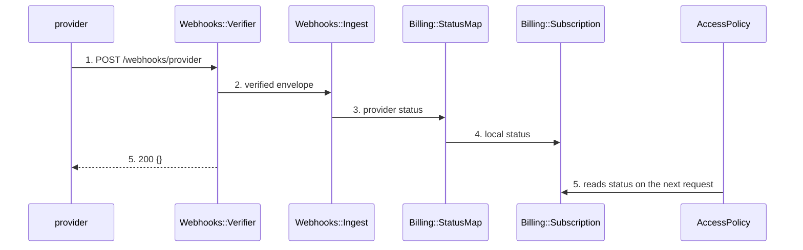
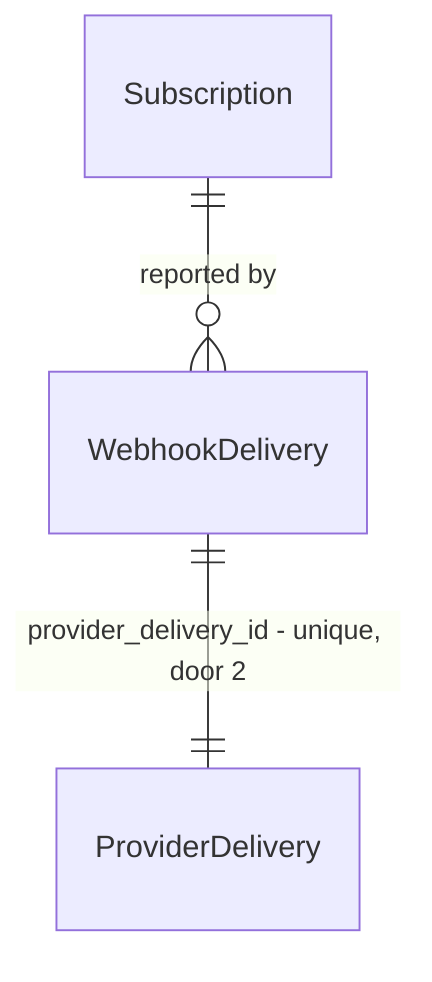

# Dunning on failed charge

## Problem

A member whose card fails keeps full access until someone notices in the provider dashboard,
which took 11 days on the last three cases. Support absorbs the refund argument and the member
learns that paying is optional.

When this ships, a failed charge suspends access within one billing cycle and the member sees why.

## Shape

Reuses `Webhooks::Verifier` and the existing 90-day pruning job for delivery rows.

1. provider `POST /webhooks/provider` -> `Webhooks::Verifier` (exists) - signature, then the envelope
2. `Webhooks::Ingest` (exists) - dedups on `provider_delivery_id`, persists `WebhookDelivery` (door 3)
3. `Billing::StatusMap` (new) - provider status -> local status
4. `Billing::Subscription` (exists) - applies the transition, persists `status`
5. out: `200` `{}`, and `AccessPolicy` (exists) reads `status` on the next request - no call from here

**Changes underneath**

| Front | What changes |
| --- | --- |
| domain | new term: `Suspended` - a subscription whose last charge failed and whose access is revoked, lives in `Billing` |
| domain | existing term: `Active` meant "has a subscription row", now means "has a subscription row and the last charge succeeded" - `AccessPolicy#grant?` and the admin index branch on it today |
| stored data | backfill now: every existing row gets `active`; the unique index runs against 40k delivery rows and fails if a duplicate already exists, so dedup the table first |

New: `WebhookDelivery` and its link to `Subscription`. One-way constraints: `provider_delivery_id` unique (door 2), `status` not null with `suspended`
in the enum (door 1).

## Surface

| Route | In | Out | Status | Who |
| --- | --- | --- | --- | --- |
| `POST /webhooks/provider` | the provider envelope as sent | `{}` · `{error}` | `200`, `401`, `409`, `422` | the provider, with a valid signature; anything else gets `401` |

## Landing

| One-way door | Literal shape | Alternative rejected |
| --- | --- | --- |
| `subscriptions.status` gains `suspended` | enum value, not null, existing rows backfilled to `active` | a boolean `is_suspended` - cannot express the next state |
| delivery id uniqueness | unique index on `webhook_deliveries.provider_delivery_id` | dedup in application code - two workers race past it |
| new entity `WebhookDelivery` | one row per delivery, keyed on the provider's delivery id | a column on `subscriptions` - one row per delivery, not per subscription |
| `POST /webhooks/provider` response codes | `200` on accepted or replayed, `409` on a concurrent duplicate, `422` on a missing subscription id | `204` - the provider retries anything without a body |

- Nothing else in this change is hard to reverse

## Criteria

### S1: Suspension on a failed charge (P1)

A failed charge suspends the subscription and paid access is denied.

**Acceptance Criteria**

1. WHEN the provider reports a failed charge THEN the system SHALL set the subscription status to `Suspended`
   - first failed charge on an `Active` subscription → `Suspended`; a second one while `Suspended` → stays `Suspended`, no new transition
2. IF the reported provider status is unknown THEN the system SHALL leave the status unchanged and record a `billing.status_unmapped` event
3. WHILE a subscription is `Suspended` the system SHALL deny access to paid access groups
4. The system SHALL never move a subscription directly from `Suspended` to `Trialing`

### S2: Webhook ingest (P1)

Replay of a delivery is a no-op; a payload without a subscription id or a valid signature is rejected.

**Acceptance Criteria**

5. WHEN a webhook delivery id has already been processed THEN the system SHALL return `200` and change no records
6. IF the provider payload is missing a subscription id THEN the system SHALL return `422` and persist nothing
7. IF a delivery carries no valid provider signature THEN the system SHALL return `401` and persist nothing

## Out of scope

| Excluded | Why |
| --- | --- |
| Retry schedule configuration | the provider already owns retries; duplicating it needs its own decision |
| Dunning emails | copy is not written yet, tracked separately |

## Assumptions

| Assumption | Chosen default | Rationale | Confirmed? |
| --- | --- | --- | --- |
| Grace period after the first failure | none - suspend on the first failed charge | the provider already retried 3 times before it reports a failure | y |
| Status for a member who was never charged | stays `Active` | absence of a charge is not a failure | y |

**Open questions:** none - all resolved or logged above.

## Sources

- TLC-412 - the suspension rule and the 11-day evidence
- provider webhook reference - the 9 statuses and the 5 event types
-  `captures/billing--card-form.png` - non-binding - user: "only the tone, the layout is ours" - the card form's wording
