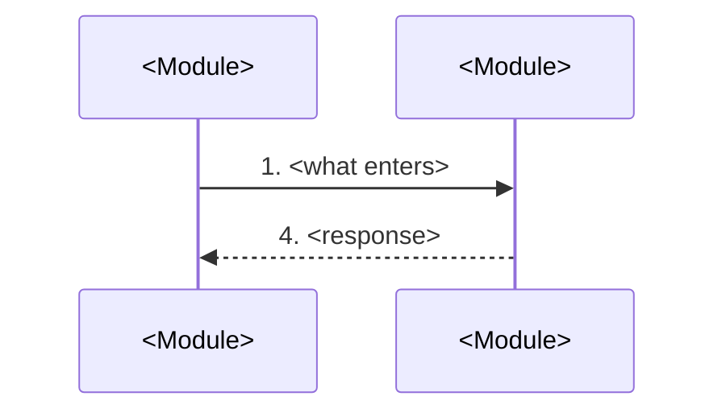

# Plan

The one artifact a human reads to understand the work and object to it, before any claim
carries a test selector. Two halves: what must be true, then what is being built. They share a
file because they are one review: deriving the checks in the same pass that decides the shape
produces checks that ratify whatever was already assumed.

Skip this file when the change is under roughly three files with no one-way door; write the
intent paragraph straight into `checks.md`.

## Before asking anything

- Load confirmed lessons: `python3 <skill-dir>/scripts/lessons.py --root <project> list --status confirmed`
  (add `--scope` or `--query` for the area). Confirmed only. No store yet: skip.
- Read `.specs/STATE.md` `## Decisions`. Every `active` `AD-NNN` constrains the shape: conform, or
  append an entry that supersedes it and say why.
- Open every binding source in full - every capture, frame and state - before the first
  criterion.

Facts you look up; decisions you ask. Ask only what is the user's: scope, priority, product
behaviour, a trade-off.

An open architectural bet (job or request cycle, which of two architectures) is settled first in
an ADR, RFC or spike and linked. This file records the shape that won.

# What must be true

## Recover the problem

Write the problem in the present tense with no solution inside it: what is true today that should
not be, who pays for it, what it costs. "We have no Stripe integration" is the absence of an
answer; "anyone evaluating the product has to enter a card first" is a problem someone can
disagree with. Copy the evidence the source gives literally, or say it gives none.

Close the section with what is different for a user when this ships. That line is the goal the
checks are held against.

## How to ask

A gray area is a decision that is the user's, has more than one defensible answer, and is not
settled by the code. Anything else is an assumption you state and move on from.

Ask every gray area before presenting the plan, until the requirements leave no product decision
to the builder. A gray area does not become an `Assumptions` row to save a question.

- "You decide" is an answer: record it in `Assumptions` with `Confirmed? y` and rationale
  `user delegated`. Write `user delegated` only when the user said it in the conversation.
- Asking clarifies how, not whether to add a capability. A new capability that surfaces goes in
  `Out of scope` with its reason.
- Removing, renaming or changing something a binding source draws is the user's call. Ask it as
  a `blocks` question with your recommendation, even when the system lacks the concept. It is
  never resolved by an `Out of scope` row alone. The answer becomes an `AD-NNN` in
  `.specs/STATE.md` whose rationale quotes the question and the option chosen; each departure it
  approves lands in `## Differences from the source` citing that id.

An assumption lands in `## Assumptions` with your default, the rationale and `Confirmed? n`. `y`
means a human said so.

Each answer goes into the plan in the turn it arrives - a criterion, an `Assumptions` row with `y`,
or an `AD-NNN` - not at the end of the conversation: a compaction keeps the file, not the chat.

## Walk the surfaces

Each kind of surface carries the same decisions every time. Walk the row for every surface this
feature exposes; each item becomes a criterion, an existing behaviour you name, or nothing to
decide. There is no table for it in the plan.

| Surface | The decisions it always has |
| --- | --- |
| a screen or view | empty, loading, error and unauthorised states; ordering of content; the window widths it must work at - the captures' sizes, or asked when no capture settles it; what a long list or a wide table does - what scrolls and what stays in view; what a destructive action confirms; what each control does when used - who acts, which control, what the page shows afterwards |
| an API or webhook | response shape, error shape with its codes, who may call it, versioning, rate limit behaviour |
| a command or scheduled task | output format, every flag and its default, exit codes, what it prints when it fails halfway |
| a document or copy | structure, tone, depth, what the reader does next |
| a collection being organised | grouping, naming, ordering, duplicates, the exception that does not fit |

The two that hide best: the error shape (decided by whoever writes the first handler) and the empty
state (invisible until a new account opens the page). State, persistence and contracts are the
nine dimensions in [checks.md](checks.md), not this list.

## Write the criteria in EARS

| Pattern | Template | Use for |
| --- | --- | --- |
| Ubiquitous | The [system] SHALL [response] | always-on invariants |
| Event-driven | WHEN [trigger] THEN the [system] SHALL [response] | a response to a discrete trigger |
| State-driven | WHILE [state] the [system] SHALL [response] | behaviour that holds during a state |
| Optional-feature | WHERE [feature is present] the [system] SHALL [response] | behaviour behind a flag |
| Unwanted-behaviour | IF [condition] THEN the [system] SHALL [response] | errors, invalid input, timeouts |
| Complex | WHILE [state], WHEN [trigger] the [system] SHALL [response] | combinations |

One requirement per criterion, with a concrete value - a status code, a field, a bound - never
"quickly" or "properly". Edge cases are criteria, usually IF/THEN.

**A control owes a gesture.** Every control this feature puts in front of a user owes a criterion
that names who acts, which control, and what the page shows afterwards. A screenshot shows the
button, never what it does. Name the use as it really happens: several files where several are
allowed, editing what exists and not only creating it.

**A screen with a binding source points at it.** Each screen or state the source draws gets one
criterion naming the gesture that reaches it and its capture files - the image, and the structural
capture beside it where there is one:

```
27. WHEN bob uses "Add cover" THEN the system SHALL show the dialog in
    `.specs/features/<f>/captures/cover.png` (`.specs/features/<f>/captures/cover.aria.yml`)
```

The builder matches the image for composition and look. Do not retype the screen into criteria;
add criteria only for what the source cannot show: what a control does, states nobody captured,
the rules behind a form. Labels and sentences a capture draws are copied from it, character for
character, in criteria and Assumptions alike; a state the capture does not draw reuses them, not a
paraphrase. Its sample data - names, quantities, dates - is not transcribed: the builder recreates
it with the capture open. A binding source is also the measure of scope: build what it draws, minus
what `## Differences from the source` lists.

**Which references bind.** A capture, screenshot, design frame or live site that comes with the
request binds: it is the result the user expects, and the user does not have to say so. It is
`non-binding` only when the user called it inspiration - a mood board, "something like X", a
product cited for its feel - and its `Sources` line quotes them: `non-binding - user: "<their
words>"`. Something the source draws that the stored model cannot hold, such as a code or a field,
is a departure asked as above, never a reason to make the source non-binding. A binding source
lives in files: export each frame or state, open ones included, to
`.specs/features/<f>/captures/` with its structure beside it where the tool gives one, keep the link
in `Sources` with the date, and ask for the files as a `blocks` question when you cannot reach it.
Each capture's `Sources` line shows the image, ``, so whoever approves
the plan sees the screen beside the criteria.

**A screen with no reference gets outcomes, not layout.** Say what a user can see and do, never
where things sit. Layout is the builder's call, held to the design system.

**A backend criterion is a rule with examples under it.** One example is the strong case - the
boundary, or the input where an implementation fitted to the obvious sample breaks.

```
12. IF a coupon has expired THEN checkout SHALL reject it with 422 `coupon_expired`
    - expired yesterday → 422; expires today at 23:59 → accepted; no expiry date → accepted
```

**One run must settle it.** A percentile, an average or an uptime is a service target, not a
criterion. Split it: the behaviour is the criterion, the target goes to observability.

**A guarantee that something will not happen needs a mechanism.** "A retry does not create a second
subscription" points at the code that enforces it, or becomes a `Landing` door. Without one it is
a question.

# What is being built

Three sections, each with a rule about what stays out: no component catalogue, no columns, no
types. Those are reversible and settled in the diff.

## Shape - the path and what it disturbs

Open with one sentence on what this reuses instead of duplicating, and one on where the rules that
change an outcome run: in a layer the repo's tests can reach, as its `AGENTS.md` or test docs say.
Filtering, searching, sorting and counting decide what a user sees, so they are rules too, not
presentation.

**The path.** One numbered line per hop: what enters, which module it crosses, what it hands on,
what persists or goes out at the end. Name only modules that exist today, marked `(exists)`, or
that a `Landing` door creates, marked `(door <n>)`; a new module with no door is `(new)` and its
placement is the builder's. `single module - <name>` is complete.

**The drawing.** The person approving the plan reads a drawing before a list, so draw the path in
mermaid: a `sequenceDiagram` for a request and its answer, a `flowchart` when it branches, fans out
or hands off to a queue or job. Number each arrow or node with its line in the list and name the
same modules in both: the list says what each hop decides, the drawing shows the shape. Both stay
true through the build.

**The data.** An `erDiagram` of the entities this reads or writes and how they relate, then one
line, `New: <entities and relations this adds>` (`New: nothing - read only` is complete). No
attribute blocks. `Data: none - <why>` when nothing stored is touched.

**States**, only when an entity or a screen moves through states: a `stateDiagram-v2` with each
transition and what triggers it. A missing transition shows in a drawing where it hides in a list
of criteria.

**Changes underneath.** A table of what already exists and changes: a domain term that changes
meaning (name who branches on it today), stored data (backfill, migrate on read, or nothing), and
each reader that will see the new data. Each reader named gets a criterion or an `Out of scope`
row.

When stored data changes, the `erDiagram` also carries the one-way constraints `Landing` settled.

## Surface - the signature

Only a route this adds or whose signature changes: route, what goes in, what comes out, statuses,
and who may call it. The statuses include what a caller who may not call gets (redirect, 401, 403
or 404); `Who: anyone` owes none. No check numbers here. `None - nothing consumed outside` is
complete.

## Landing - the one-way doors

A door is one-way when reversing it costs more than a refactor: a persisted schema, a contract
someone consumes, a new dependency, a backfill, a pattern the codebase does not have yet. Each row
gives the literal shape the next person copies and the alternative rejected, with the property
that disqualified it. Scope and rules with no persisted mechanism are not doors. Identifier width,
uniqueness, nullability over a populated table and a field a consumer binds to are doors.
`None - <why nothing here is one-way>` is complete. A door that reaches past this feature also goes
in `.specs/STATE.md` `## Decisions` ([memory.md](memory.md)).

# Before presenting

```bash
python3 <skill-dir>/scripts/validate_plan.py <feature>
```

It checks the structure. What it cannot see stays yours: a hop marked `(exists)` only stands if
that module already does what the criteria assign it. And read the request again, one sentence at a
time: each one lands on a criterion, an `Out of scope` row or an open question. A sentence that lands
nowhere is the requirement that goes missing, and nobody downstream reads the request again.

Every unresolved decision is a criterion, an `Assumptions` row, or an open question marked
`blocks`, `blocks go-live` or `open`.

## Template: `.specs/features/<feature>/plan.md`

`````markdown
# <Feature>

**Approved**: <written when the user approves - YYYY-MM-DD - user: "their words">

## Problem

<Present tense, no solution inside it: what is true today, who pays, what it costs. The evidence
the source gives, or a note that it gives none.>

<What is different for a user when this ships.>

## Shape

<One sentence: what this reuses instead of duplicating. One sentence: where the rules that change an outcome run, in a layer the repo's tests reach.>

1. <what enters> -> `<Module>` (exists) - <what it does, what it hands on>
2. `<Module>` (exists) - <what it does>, persists `<Entity>` (door <n>)
3. `<Module>` (new) - <what it decides>
4. out: `<response>`, and `<Module>` (exists) reads `<field>` on the next request



**Changes underneath**

| Front | What changes |
| --- | --- |
| domain | `<Name>` meant <x>, now means <y> - <who branches on it today> |
| stored data | <backfill now / migrate on read / nothing to migrate> |
| readers | <screen or job that shows the new data> |

```mermaid
erDiagram
    <Entity> ||--o{ <Entity> : "<verb>"
```

New: <entities and relations this adds, or `nothing - read only`>. One-way constraints: <field>
unique (door <n>).

<Only when something moves through states:>



```mermaid
stateDiagram-v2
    [*] --> <State>
    <State> --> <State> : <trigger>
```

## Surface

| Route | In | Out | Status | Who |
| --- | --- | --- | --- | --- |
| `<METHOD> /<path>` | `<field>` | `<field>` | `<code>`, `<denied code>` | <who may call it, and what the rest get> |

## Landing

| One-way door | Literal shape | Alternative rejected |
| --- | --- | --- |
| <what> | <the literal a reader copies> | <the option, and the property that disqualified it> |

- Nothing else in this change is hard to reverse

## Criteria

### S1: <slice - the outcome someone can watch> (P1)

<One line: the outcome this slice is.>

**Acceptance Criteria**

1. WHEN <trigger> THEN the system SHALL <observable outcome with the concrete value>
2. IF <undesired condition> THEN the system SHALL <response>
   - <example> → <result>; <the strong case> → <result>
3. WHEN <who> <gesture> THEN the system SHALL show the <screen> in `<image>` (`<structural capture>`)

## Out of scope

| Excluded | Why |
| --- | --- |
| <capability> | <reason> |

## Assumptions

| Assumption | Chosen default | Rationale | Confirmed? |
| --- | --- | --- | --- |
| <ambiguity> | <what we will do> | <why> | y/n |

**Open questions:** none - all resolved or logged above.

## Differences from the source

<Only when a source binds. Every way the product departs from what the source draws, each one
approved by the user.>

| Source shows | Product shows | Confirmed |
| --- | --- | --- |
| <label, control or state in the capture> | <what the product shows instead, or nothing> | y - <AD-NNN holding the question and the answer> |

<Or:> None - the product matches the source

## Sources

- <ticket or binding design> - binding - <what it settles>
-  - binding - <what it draws>
- <what the user called inspiration> - non-binding - user: "<their words>" - <what it informs>
`````

## Then confirm

Present the plan and stop: this is the one default stop for a human. Name `Shape`, any `Landing`
door with a live alternative, and anything that changes existing data or a consumed contract.
When the user approves, write `**Approved**: <YYYY-MM-DD> - user: "<their words>"` under the
title; one the user did not give is never written, and `validate_checks.py` refuses to start
without it. Then continue into [checks.md](checks.md).

## Notes

- P1 is a vertical slice, not a layer. Priority orders the work and never scales down verification.
- A criterion you cannot imagine a test for is not ready.
